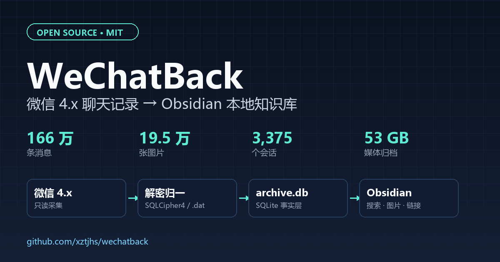

# 166 万条微信聊天记录，我把它搬进了 Obsidian：WeChatBack 开源实战



> 摘要：微信自带的备份只能恢复到微信里，不能全文检索。本文记录我把 166 万条微信 4.x 聊天记录、19.5 万张图片、3,061 个文件导出为 Obsidian 本地知识库的完整过程，包括 SQLCipher4 数据库、`.dat` 图片解密、媒体去重、增量维护和 SMB 踩坑。项目已开源。
>
> 项目地址：<https://github.com/xztjhs/wechatback>
>
> 技术栈：Python 3.11 / SQLite / SQLCipher4 / Obsidian / PowerShell
>
> 建议标签：微信备份、Obsidian、数据归档、Python、SQLite

---

## 一、为什么要做这件事

微信自带的“聊天记录备份与迁移”只能把数据恢复到微信里。它能保证数据不丢，却不能回答几个很实际的问题：

- 三年前某个客户在群里报过什么价格？
- 某个项目从第一次接触到最终报价，完整时间线是什么？
- 某个关键词只在图片、文件或某个月的群聊里出现过，怎么快速找？
- 换电脑后，能不能不依赖微信客户端，直接用一个本地知识库检索？

我的工作场景是销售，微信里有大量客户、项目、报价、群聊和文件。我的目标不是“把微信数据库复制一份”，而是把它变成一个 **Obsidian 可以直接打开、直接全文搜索、可以长期增量维护的本地知识库**。

于是有了 WeChatBack。

它做四件事：

1. 只读读取本机、本人账号的微信 4.x 数据；
2. 把聊天记录归一成 SQLite 事实层；
3. 把事实层渲染成 Obsidian Markdown；
4. 图片解密、视频/文件按 SHA-256 去重，支持增量更新。

先看最终结果。

---

## 二、最终效果

在一台 Windows 11 机器、微信 4.1.15.13 上，我完成了一次全量导出：

| 项目 | 结果 |
|---|---|
| 消息 | 1,663,631 条 |
| 会话 | 3,375 个 |
| 月份笔记 | 17,439 篇 |
| 图片（去重后） | 195,022 个 |
| 缩略图 | 186,622 张 |
| 视频（去重后） | 640 个 |
| 文件（去重后） | 3,061 个 |
| 媒体合计 | 198,723 个，约 52.8 GB |
| Vault 总大小 | 约 53 GB |
| 源数据校验 | 100/100 文件未修改 |

打开 Obsidian 后，目录大概是这样：

```text
WeChatBackVault/
├─ 10_Chats/        每个会话、每个月一个 Markdown
├─ 20_Media/
│  ├─ Images/       解密后的原图
│  ├─ Thumbs/       缩略图
│  ├─ Videos/       去重视频
│  └─ Files/        去重文件
├─ 30_Index/        Dataview 会话总览
└─ README.md
```

每篇笔记带 YAML frontmatter，正文按时间排列，图片默认显示缩略图，点击可以看原图；视频、文件是相对链接，直接点开。

这不是一个“只能看”的静态导出。后续微信里来了新消息，跑一条增量命令就能补进来：

```powershell
powershell -ExecutionPolicy Bypass -File .\scripts\publish.ps1
```

---

## 三、整体架构

核心思路是 **事实层与阅读层分离**：

```text
微信 4.x（只读）
  db_storage/*.db          msg/attach/**/*.dat       msg/video|file/**
        │                         │                        │
        │ 取钥/解密                │ 直接只读                │ 直接只读
        ▼                         ▼                        ▼
  DB Decryptor              Image Decoder             Media Hasher
  SQLCipher4                AES + XOR + WXGF          SHA-256 去重
        │                         │                        │
        └──────────────┬──────────┴────────────┬───────────┘
                       ▼                       ▼
              archive.db（SQLite）        pending_media / state.db
                       │
                       ▼
              Obsidian Vault
              10_Chats / 20_Media / 30_Index
```

几个关键设计：

- **`archive.db` 是唯一事实源**。消息、会话、媒体映射先入库；Markdown 只是它的确定性投影，随时可以重建。
- **源数据只读**。不写、不改、不移动微信原始目录，不对源库执行 `VACUUM` 或 checkpoint。
- **图片全部解密为真实格式**。jpg/png/gif/webp/bmp，不再保留 `.dat`；WXGF/HEVC 用 ffmpeg 转码。
- **视频/文件按内容哈希去重**。同一个 SHA-256 只存一份，多个会话引用同一个文件。
- **增量靠水位 + 回看窗口**。每个会话记录 `last_ts`，每次向前回看 7 天，按 `msg_id` 幂等 upsert。

---

## 四、技术难点一：微信 4.x 的数据库

微信 4.x 使用 WCDB / SQLCipher4 变体：

- AES-256-CBC 加密；
- HMAC-SHA512 校验；
- page size 4096；
- reserve 80 字节；
- KDF 是 PBKDF2-HMAC-SHA512，256,000 轮。

4.1+ 版本还有一个变化：进程内存里不再缓存明文 raw key，只保留 passphrase。老式“内存里搜 64 位 hex”的工具会全部失效。需要从运行中的 `Weixin.exe` 进程里定位 `com.Tencent.WCDB.Config.Cipher` 对象，拿到 passphrase/候选 key，再用每个数据库自己的 salt 做 PBKDF2，最后用 HMAC 校验。

这一步我使用了 MIT 协议的 [wcdb-key-tool](https://github.com/TANGandXUE/wcdb-key-tool)，并把它放进了项目的 `tools/wcdb-key-tool/`。它只读扫描本机微信进程，不修改微信、不接触网络。

解密后的数据库就是标准 SQLite，可以直接用 `sqlite3` 查询。我的原则是：

> 先跑 20 条样本，确认密钥、字段、媒体映射都对，再跑全量。

全量 27 个库中命中 26 个，只有 `migrate/unspportmsg.db` 没有 key，属于正常情况。

---

## 五、技术难点二：`.dat` 图片

这是整个项目里最容易踩坑的部分。

微信 4.x 的图片缓存是 `.dat` 文件，V2 结构大致如下：

```text
[15 字节头]
  sig      = 07 08 56 32 08 07
  aes_size = LE u32
  xor_size = LE u32
  pad      = 01
[AES-128-ECB 段，长度 = aes_size + 16]
[PKCS#7 unpad]
[XOR 尾段，长度 = xor_size]
```

三个关键点：

### 1. AES 段长度必须取 `aes_size + 16`

只取 `aes_size` 会得到一种很迷惑的现象：**第一块解密看起来像图片头，但整张图打不开**。因为最后 16 字节是 PKCS#7 填充，必须一起解密再 unpad。

### 2. 图片密钥不是从账号目录推导的

图片 AES key 的正确来源是：

```text
AES key = MD5(十进制 UIN + wxid)[:16] 的 ASCII 字节
XOR key = UIN & 0xFF
```

其中 UIN 来自：

```text
%APPDATA%\Tencent\xwechat\{net,net_1,ilink,roam\ilink}\kvcomm\key_<UIN>_*.statistic
```

注意：**账号目录后缀、`head_imgs` 目录名都不是 UIN**。用错 UIN 的典型症状就是“首块像图、整图错”。

### 3. 校验必须用 PIL 打开整图

只看文件头魔数不够。我的校验方式是：解密后用 PIL 完整打开一次，能 decode 才算通过。这样能避免“密钥看起来对、实际只对了第一块”的假成功。

另外，解出的载荷可能是 `wxgf`，内部是 HEVC。处理方式是扫描 `00 00 00 01` / `00 00 01` 起始码，把 Annex-B 流交给 ffmpeg 取首帧：

```powershell
ffmpeg -f hevc -i input.hevc -frames:v 1 output.png
```

最终 36 万张 `.dat` 中，图片失败 1,482 张，失败率 0.64%，全部是源文件本身截断/损坏，不是解密算法问题。

---

## 六、技术难点三：消息类型与媒体映射

微信的 `local_type` 不是一个普通枚举，而是位打包：

```python
base_type = local_type & 0xFFFFFFFF
subtype   = local_type >> 32
```

例如：

```text
25769803825 = (6 << 32) | 49   # 文件
21474836529 = (5 << 32) | 49   # 链接
```

如果只判断 `local_type == 49`，会漏掉大量富媒体。

媒体映射也不是一条 SQL 能解决的：

| 类型 | 本地文件名来源 | 路径 |
|---|---|---|
| 图片 | `packed_info_data` 末尾 32 位 ASCII hex | `msg/attach/<md5(chat_id)>/<YYYY-MM>/Img/<md5>.dat` |
| 缩略图 | 同上 | `<md5>_t.dat` |
| 高清图 | 同上 | `<md5>_h.dat` |
| 视频 | XML `md5` / `originsourcemd5` → `video_hardlink_info_v4`；缺失时按 `(月份, length)` 匹配 | `msg/video/<YYYY-MM>/<file>.mp4` |
| 文件 | XML `md5` → `file_hardlink_info_v4`；兜底 `msg/file/<月份>/<title>` | 原文件名 |

视频和文件复制时按 SHA-256 去重。这样同一个文件在十个群里出现，Vault 里也只保留一份。

---

## 七、技术难点四：Obsidian 与 SMB

Obsidian 对 Markdown 很友好，但对 40 万文件并不友好。

我一开始把 Vault 直接放在 NAS 的 SMB 共享上，结果 Obsidian 启动索引时几乎卡死：405,303 个文件、51.1 GiB，元数据延迟太高。最后的方案是：

- **本地 NVMe 工作库**：`D:\WeChatBackVault`，Obsidian 打开这个；
- **NAS 冷备**：每天/每次增量后同步过去；
- **Obsidian 排除 `20_Media/`**：图片仍能显示，但搜索和索引不再扫描几十万媒体文件。

另一个很隐蔽的坑是 SMB 的 `Path.exists()` 缓存。代码里如果写：

```python
if not output.exists():
    write(output)
```

在 SMB 上可能命中旧缓存，导致“数据库里有记录，但文件其实没写”。我最后的修复是：**不要用 `exists()` 跳过写入**，图片、缩略图、视频、文件一律写/复制，临时文件名加 `pid + thread_id`，最后 `os.replace`。

还有一个 Markdown 细节：文件名包含空格或括号时，链接会断在第一个 `)`。解决方式是给链接目标加尖括号：

```markdown
[📎 报表(1).xlsx](<../../../20_Media/Files/<sha>_报表(1).xlsx>)
```

---

## 八、增量维护：只处理新消息

全量导出是一次性成本，日常维护才是长期成本。

WeChatBack 的增量逻辑：

1. `state.db` 保存每个会话的 `last_ts`；
2. 每次查询 `create_time >= last_ts - 7 天`，留出回看窗口；
3. 新增的 `message_N.db` 分片、新会话自动纳入；
4. 按 `msg_id` upsert，撤回/编辑会更新归档，不删除历史；
5. Markdown 内容没有变化时跳过重写。

我实测重扫了 64,012 条近期消息，归档计数保持不变，说明增量链路正常。

日常只需要一条命令：

```powershell
$env:WECHATBACK_BACKUP = '\\NAS\Backup\WeChatBack'
powershell -ExecutionPolicy Bypass -File .\scripts\publish.ps1
```

它会依次执行：

```text
export --incremental
  → 同步 Vault 到备份根目录
  → 同步 archive.db / state.db / 日志到 90_System
```

如果微信里后来补下载了视频或文件：

```powershell
powershell -ExecutionPolicy Bypass -File .\scripts\repair-missing.ps1 -Kind video
powershell -ExecutionPolicy Bypass -File .\scripts\repair-missing.ps1 -Kind file
```

---

## 九、实测过程与结果

### 时间线

| 时间 | 事件 |
|---|---|
| 10-22 22:30 | 现状勘察：微信 4.1.15.13，53.08 GB / 403,425 文件 |
| 10-22 23:20 | DB key 提取 26/27；图片 key 样本 30/30 |
| 10-22 23:58 | 全量导出启动 |
| 10-23 00:12 | 消息归一完成：1,663,631 条 |
| 10-23 08:29 | 图片、视频/文件、Markdown 渲染完成 |
| 10-23 09:00 | 验收：源数据未变、Vault 内图片 `.dat` = 0 |
| 10-23 09:20 | 修复 SMB `exists()` 缓存，补跑 1,118 张缺失图片 |
| 10-23 20:39 | 复制 Vault 到本地，Obsidian 改开本地库 |
| 10-23 22:41 | 补 10,565 张缩略图，修复文件链接括号 |
| 10-23 22:51 | 本地库同步回 NAS，0 失败 |

全量耗时约 8.5 小时，主要花在 36 万张图片解密、缩略图生成和 Markdown 渲染上。

### 结果

| 类型 | 成功 | 失败 | 缺失 |
|---|---|---|---|
| 图片 | 232,192（99.36%） | 1,482（0.64%） | 0 |
| 视频 | 640（3.70%） | 0 | 16,658（96.30%） |
| 文件 | 3,187（28.04%） | 17（0.15%） | 8,161（71.81%） |

这里要解释一下“缺失”：

- 图片失败：源 `.dat` 下载不完整，无法恢复；
- 视频/文件缺失：微信本地只保留了缩略图或消息记录，原文件从未下载到本机。

这不是解密失败，而是微信本地缓存的边界。打开对应聊天、让微信重新下载后，再跑 `repair-missing` 就能补进来。

### 验收

- 源数据快照 100 个文件：`changed=0 / missing=0`；
- Vault 内图片 `.dat` = 0；
- `media` 表 198,723 行，`export_path` 缺失 0；
- 300 篇笔记抽样：frontmatter、消息 ID、日期标题 0 错；
- 400 篇链接抽样：真实断链 0；
- 增量重扫 64,012 条消息，计数稳定。

---

## 十、如何复现

### 1. 克隆和安装

```powershell
git clone https://github.com/xztjhs/wechatback.git
cd wechatback

py -3.11 -m venv .venv
.venv\Scripts\activate
pip install -e .
```

### 2. 配置

```powershell
mkdir "$env:USERPROFILE\.wechatback"
copy config.example.toml "$env:USERPROFILE\.wechatback\config.toml"
notepad "$env:USERPROFILE\.wechatback\config.toml"
```

至少改两个路径：

```toml
[vault]
root = 'D:\WeChatBackVault'
system_dir = 'C:\Users\YOUR_NAME\.wechatback'

[wechat]
data_root = 'D:\WeChatData\xwechat_files'
```

### 3. 提取密钥并解密数据库

管理员 PowerShell，微信保持登录：

```powershell
powershell -ExecutionPolicy Bypass -File .\scripts\decrypt-db.ps1
```

### 4. 验证图片密钥

```powershell
wechatback image-key probe
```

### 5. 先跑 20 条

```powershell
wechatback export --full --limit 20
```

确认 `10_Chats` 有笔记、图片能显示、链接能点开，再跑全量：

```powershell
wechatback export --full
```

### 6. Obsidian

1. 打开本地 Vault；
2. 设置 → 文件与链接 → 新建链接格式选 **相对路径**；
3. 安装 Dataview（可选）；
4. 打开 `30_Index/会话总览.md`；
5. 全局搜索 `Ctrl+Shift+F`。

---

## 十一、边界与风险

这个项目不是“万能微信导出器”，有几个明确边界：

1. **版本敏感**：微信 4.x 的数据库和 `.dat` 格式会随版本变化。升级后先跑 `doctor` + 20 条/20 张样本。
2. **只能导出本地已有数据**：视频/文件如果微信从未下载，工具无法凭空恢复。
3. **语音未导出**：正文显示 `[语音 Ns]`。
4. **WXGF 动图只取首帧**：当前是静态 PNG。
5. **需要管理员权限**：提取 DB key 要读取微信进程内存；不支持绕过登录或远程抓取。
6. **隐私风险**：导出结果包含他人聊天内容。请使用 BitLocker/VeraCrypt，限制 NAS 权限，不要上传网盘或公开仓库。

最重要的一条：

> 只用于导出**本人本机、本人账号**的聊天数据。不要用它处理别人的数据。

---

## 十二、总结

这个项目做完，我最大的三个体会是：

1. **事实层比 Markdown 重要**。先把消息、会话、媒体映射归一成 SQLite，Markdown 只是投影；否则每次改格式都要重跑全量。
2. **样本先行**。20 条消息、20 张图片跑通，再开 36 万张图的全量批处理，能省掉大量返工。
3. **SMB 不适合放 40 万文件**。本地工作库 + NAS 冷备，是体验和备份强度之间的最佳平衡。

项目已经开源，代码、方案、数据字典、踩坑记录和 skill 都在仓库里：

**<https://github.com/xztjhs/wechatback>**

如果这个项目对你有帮助，欢迎 Star、提 Issue，或者把它改成适合你自己工作流的版本。

---

> 免责声明：本文及项目仅用于个人本机、本人账号的数据备份与检索。请遵守当地法律法规、微信服务条款及所在组织的合规要求，不要用于侵犯他人隐私或未经授权的数据获取。
